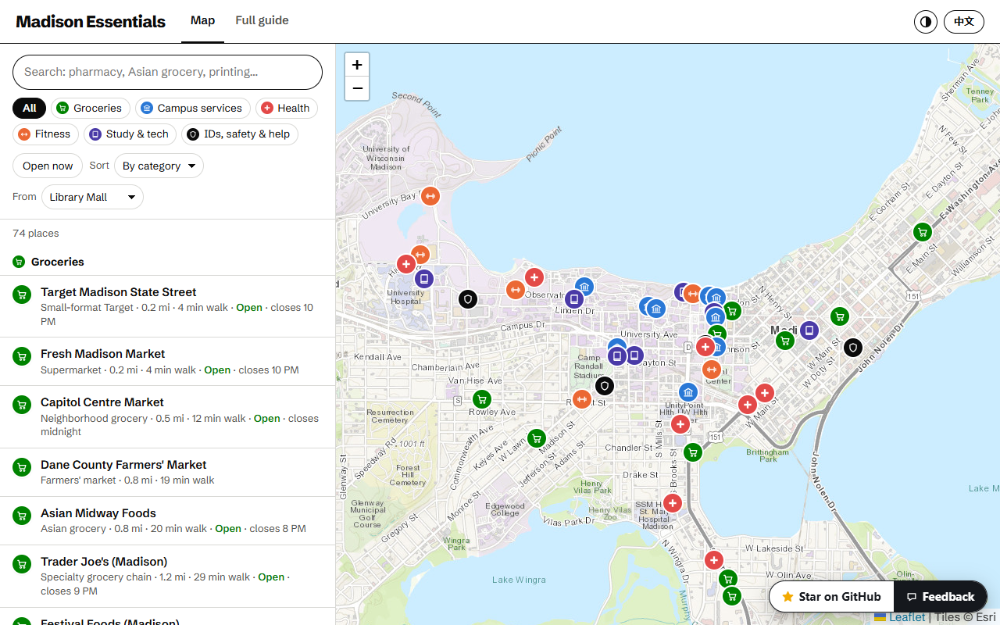
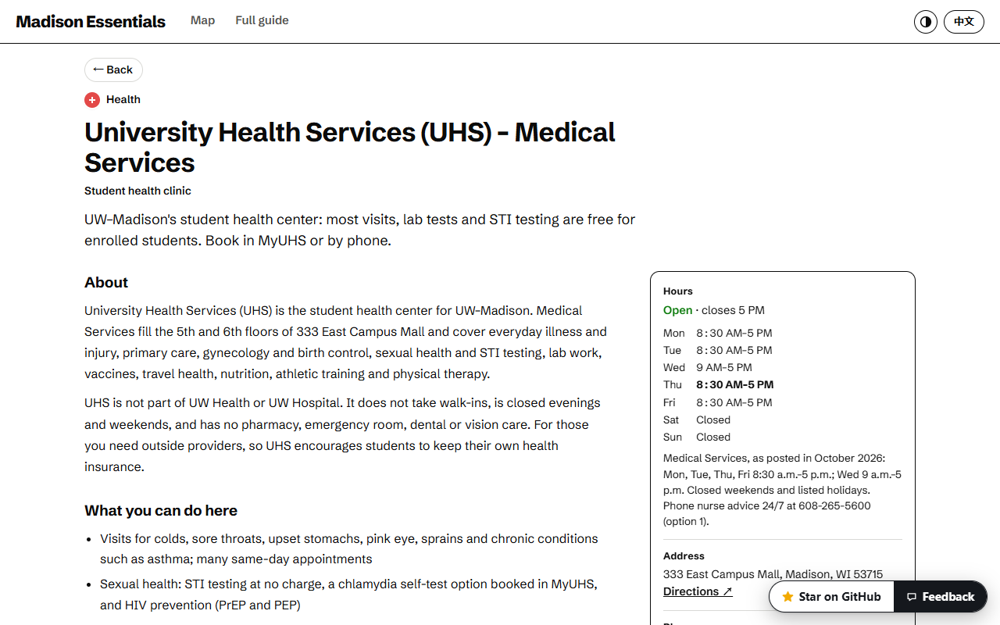

# Madison Campus Guide

**Live site: https://webgrs.github.io/madison-campus-guide/**

The everyday places around the UW–Madison campus, each explained in English and Chinese:
what the place is, what you can do there, how to use it, what it costs and who may use it,
practical tips, and notes for international students. Built for new students.

## What's in it

131 places:

- Groceries: 21
- Shopping & services: 20
- Campus services: 16
- Health: 16
- Free time: 15
- Banks, mail & utilities: 12
- Getting around: 9
- Study & tech: 8
- Fitness: 7
- IDs, safety & help: 7

Each place has its own page with opening hours (and whether it is open now, in Madison
time), address and directions, phone, website, distance from campus, and the nearest
Madison Metro stops. The **Full guide** tab puts every place on one page with a table of
contents.

## How the facts were checked

Every address, phone number, opening time, price and eligibility rule in an entry is tied
to a verbatim quote from the page it came from — 3,671 quotes in total, each matched
again against a saved copy of its source before publishing. Each place lists its sources
and the date it was checked (last check: 2026-10-08). Hours and rules change, so confirm on
the official site before you go.

Coordinates come from OpenStreetMap and were cross-checked with the US Census geocoder.
Bus stops come from the Madison Metro Transit GTFS feed. Map tiles: Esri.

Not affiliated with the University of Wisconsin–Madison.
